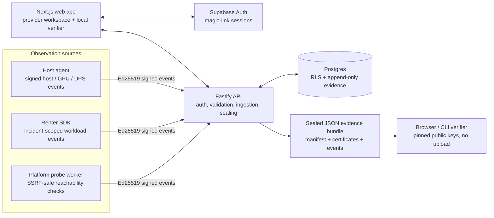

<div align="center">

# Incident Witness

**A Portable Incident-Evidence Protocol for Decentralized Compute**

Signed, bounded observations from independent infrastructure sources — correlated into one deterministic timeline and sealed into an offline-verifiable evidence bundle.

<p>
  
  
  
  
</p>

[Quickstart](#-quickstart) · [Architecture](#-architecture) · [Features](#-features-of-the-boilerplate) · [Build your own](#-how-to-build-your-own-protocol) · [Reference implementation](#-the-incident-witness-reference-implementation-hackathon-demo)

</div>

---

> **Evidence, not adjudication.** A valid signature proves that a record has not changed since it was signed by a particular key. It does not prove that a sensor was truthful, a host was uncompromised, or an inferred cause is correct. This project reports source-attributed observations and evidence patterns — not root causes or marketplace decisions.

## 🚀 Quickstart

### Prerequisites

- **Node.js 26.13.0** and npm 11.x (pinned in `.node-version` / `package.json`)
- A **Supabase** project with Postgres and Auth enabled
- Network access to the database for migrations
- Optional for real host telemetry: Linux x86_64, `nvidia-smi`, and Network UPS Tools (`upsc`)

### Install and configure

```bash
git clone https://github.com/onyebuchidaniel60/incident-witness.git
cd incident-witness
npm ci
cp .env.example .env
```

Fill `.env` with **local or staging** values. Never commit `.env`, database URLs, signing keys, credentials, or service-role material. Browser-visible configuration must stay limited to `NEXT_PUBLIC_*` values. Configuration reference: [`docs/CONFIGURATION.md`](docs/CONFIGURATION.md).

### Prepare the database and signing key

```bash
npm run db:provision-roles
npm run db:migrate
npm run db:provision-platform-key
npm run db:migrate:status
```

`DATABASE_URL_MIGRATOR` is used only for migrations. The API connects as `iw_api`; the probe worker connects as `iw_worker`. Both runtime roles are non-superuser and do not bypass RLS.

### Run locally

```bash
# Terminal 1 — Fastify API
npm run dev:api

# Terminal 2 — Next.js web app
npm run dev
```

Default local endpoints:

| Service | URL |
| --- | --- |
| Web app | `http://localhost:3000` |
| API | `http://localhost:4000` |
| API readiness | `http://localhost:4000/health/ready` |

Set `NEXT_PUBLIC_API_BASE_URL`, `IW_ALLOWED_WEB_ORIGINS`, and the Supabase public values consistently.

### Deploy

| Component | Target | Notes |
| --- | --- | --- |
| Web app | **Vercel** | Project root `apps/web`; set the `NEXT_PUBLIC_*` values in the Vercel project. |
| API | **Render Web Service** | `render.yaml` defines the build and `node apps/api/dist/index.js` start command. |
| Probe worker | **Render Background Worker** | Separate service and separate restricted database role. No public ingress. |
| Database / Auth | **Supabase** | Apply migrations through the migrator role; keep staging and production projects separate. |

See [`docs/DEPLOYMENT.md`](docs/DEPLOYMENT.md) and [`render.yaml`](render.yaml) for the complete deployment and environment-variable contracts.

### Verify the build

```bash
npm run lint
npm run typecheck
npm run build
npm test
npm run test:e2e
```

For a full local provider journey, see [`docs/USER_GUIDE.md`](docs/USER_GUIDE.md). For a labelled synthetic evidence lifecycle, run `npm run demo`; it seals a bundle and verifies a one-byte tamper failure with the offline CLI.

## 🏗️ Architecture



The protocol separates **observation sources** from the **evidence record**:

- The **host agent** runs on the provider's Linux host and records bounded heartbeats plus available GPU, UPS, and lifecycle observations.
- The **renter SDK** runs alongside a renter workload and records only heartbeat and endpoint observations. It never collects workload content.
- The **platform probe** is a separate platform-operated worker that checks the provider's verified HTTPS health endpoint. It is **not an independent third party**.

The API correlates accepted observations deterministically, then seals a portable bundle. The browser verifier and CLI both use the same protocol package and pinned trust anchors; neither uploads the bundle. See [`docs/planning/ARCHITECTURE.md`](docs/planning/ARCHITECTURE.md) for the complete trust model, schema, API, concurrency and security contracts.

## ✨ Features of the Boilerplate

| Capability | What is included |
| --- | --- |
| **Signed evidence** | Ed25519 event signatures, RFC 8785 JCS canonical JSON, SHA-256 digests, source registration certificates and signed bundle manifests. |
| **Deterministic rules** | Pure `@incident-witness/correlator` package with versioned rules, explicit `UNKNOWN`, evidence grades, gap handling and simulation caps. No LLM, no probability score. |
| **SSRF-safe probe** | Fixed HTTPS hostname/path/port, DNS validation, private/reserved/loopback/metadata address rejection, pinned validated address, no redirects or proxy environment. |
| **Offline verification** | Browser verifier using public-key-only Ed25519 and a Node CLI (`iw-verify`) sharing the same protocol fixtures and trust-set model. |
| **Provider workspace** | Next.js App Router UI for hosts, DNS ownership proof, enrollment, bounded sessions, renter invitations, timeline, source health, sealing and downloads. |
| **Observer tooling** | Linux host agent with owner-only key storage and SQLite spool; incident-scoped TypeScript renter SDK with bounded queue and retry; separate probe worker with Postgres job leases. |
| **Defense in depth** | Supabase JWT verification, restricted database roles, RLS policies, owner-scoped 404 responses, append-only evidence and transactional sealing. |
| **Testable by default** | Vitest unit suites, Playwright browser journeys, staging integration tests, cross-runtime canonical/signature vectors and a reproducible demo harness. |

The project deliberately does **not** include payments, financial logic, AI diagnosis, blockchain/Arweave storage, marketplace reputation changes, arbitrary log ingestion, arbitrary command execution, or public-by-default evidence.

## 🛠️ How to Build Your Own Protocol

This repository is a working reference architecture, not a locked product. A fork can define a different evidence domain while preserving the signed-record and verification pattern.

### 1. Fork and rename

```bash
git clone https://github.com/onyebuchidaniel60/incident-witness.git my-evidence-protocol
cd my-evidence-protocol
```

Update package names, UI copy, vertical labels, and the pinned platform trust set. Keep the protocol/version boundary explicit so old bundles remain verifiable.

### 2. Define your sources and trust boundaries

Decide which categories produce observations and what each source is honestly able to prove. The reference implementation uses three categories:

- provider-controlled host agent
- renter-controlled workload client
- platform-operated network probe

Do not relabel a platform-operated source as an independent third party. Do not imply that a signature proves sensor truth or physical cause.

### 3. Customize the event schema

The single source of truth for the signed envelope and allowed payload fields is:

```text
packages/protocol/src/core/schemas.ts
```

Keep every payload typed, bounded, and free of free-form logs, prompts, datasets, credentials, or arbitrary process output. If you add a field:

1. Add it to the strict Zod schema.
2. Add protocol fixtures and canonical-byte tests.
3. Reject unknown fields at the API boundary.
4. Update the host agent / renter SDK / probe producer.
5. Update the offline verifier allow-list and test vectors.

The API must continue to require exact canonical request bytes, signature verification, key scope/status, sequence monotonicity, incident time-window checks, and idempotency.

### 4. Change the deterministic rules

Rules live in:

```text
packages/correlator/src/rules.ts
packages/correlator/src/types.ts
```

The correlator is a pure function: the same normalized events plus the same rule version must always produce the same output. If you change a rule:

- bump `RULE_VERSION` in `types.ts`;
- keep the rule inputs explicit and deterministic;
- add positive, negative, contradictory, missing-source and simulation cases;
- preserve `UNKNOWN` when evidence is insufficient;
- update the assessment wording and in-app rules explanation;
- keep the rule version in every sealed manifest.

### 5. Adapt persistence, API, and UI

Use the existing boundaries as a checklist:

| Area | Location |
| --- | --- |
| Database schema and migrations | `packages/db/migrations/` |
| API routes and domain services | `apps/api/src/routes/`, `apps/api/src/domain/` |
| Host collectors and spool | `packages/host-agent/src/collectors/`, `packages/host-agent/src/spool.ts` |
| Renter event behavior | `packages/renter-sdk/src/` |
| Probe policy and network client | `apps/probe-worker/src/probe.ts`, `apps/probe-worker/src/dns.ts`, `apps/probe-worker/src/ip.ts` |
| Provider workspace | `apps/web/app/(dashboard)/`, `apps/web/components/views/` |
| Local verification | `apps/web/lib/verify/`, `tools/iw-verify/` |

Any schema, permission, state-machine, or trust-boundary change is a product/security decision. Record it in an ADR before implementation.

### 6. Re-pin trust and rerun the evidence tests

Before publishing a fork:

```bash
npm ci
npm run lint
npm run typecheck
npm run build
npm test
npm run test:integration --workspace @incident-witness/api
npm run test:integration --workspace @incident-witness/probe-worker
npm run test:e2e
npm run demo
```

Update both pinned trust sets when rotating platform keys:

- `tools/iw-verify/trusted-platform-keys.json`
- `apps/web/lib/verify/trusted-platform-keys.ts`

Validate a valid bundle, a modified manifest, a modified event signature, an unknown key, an unsupported version, and a one-byte tamper. Keep the browser and CLI results identical.

### Documentation map

| Need | Document |
| --- | --- |
| Product behaviour and acceptance criteria | [`docs/planning/PROJECT_SPEC.md`](docs/planning/PROJECT_SPEC.md) |
| Architecture, trust model and data contracts | [`docs/planning/ARCHITECTURE.md`](docs/planning/ARCHITECTURE.md) |
| Build sequence and gates | [`docs/planning/IMPLEMENTATION_PLAN.md`](docs/planning/IMPLEMENTATION_PLAN.md) |
| Current execution checkpoint | [`docs/planning/AI_HANDOFF.md`](docs/planning/AI_HANDOFF.md) |
| Provider journey | [`docs/USER_GUIDE.md`](docs/USER_GUIDE.md) |
| Host agent | [`docs/HOST_AGENT.md`](docs/HOST_AGENT.md) |
| Renter SDK | [`docs/RENTER_SDK.md`](docs/RENTER_SDK.md) |
| Probe worker | [`docs/PROBE_WORKER.md`](docs/PROBE_WORKER.md) |
| Protocol and bundle format | [`docs/PROTOCOL.md`](docs/PROTOCOL.md) |
| API index | [`docs/API_REFERENCE.md`](docs/API_REFERENCE.md) |
| Deployment | [`docs/DEPLOYMENT.md`](docs/DEPLOYMENT.md) |
| Operations and troubleshooting | [`docs/OPERATIONS.md`](docs/OPERATIONS.md), [`docs/TROUBLESHOOTING.md`](docs/TROUBLESHOOTING.md) |
| Privacy and security model | [`docs/PRIVACY_SECURITY.md`](docs/PRIVACY_SECURITY.md) |

### Repository layout

```text
.
├── apps/
│   ├── web/                 # Next.js provider workspace, public docs and local verifier
│   ├── api/                 # Fastify API, auth, ingestion, sealing
│   └── probe-worker/        # SSRF-safe platform probe worker
├── packages/
│   ├── protocol/            # JCS, Ed25519, schemas, certificates, bundle verification
│   ├── correlator/          # pure deterministic rule engine
│   ├── db/                  # Drizzle schema and SQL migrations
│   ├── host-agent/          # Linux host agent and SQLite spool
│   ├── renter-sdk/          # incident-scoped renter client
│   └── ui/                  # shared behavioral UI primitives
├── tools/
│   ├── iw-verify/           # offline Node bundle verifier
│   └── demo-harness/        # labelled synthetic evidence lifecycle
├── scripts/demo/            # Playwright + Edge TTS + FFmpeg demo pipeline
├── docs/                    # user, operator, protocol and planning documentation
└── .github/                 # CI and repository automation
```

### Contributing and agent rules

The repository is implemented one task/phase at a time. Read [`AGENTS.md`](AGENTS.md) before changing code. Architecture, product behaviour, security, evidence claims, and state-machine changes require operator approval.

For a safer contribution:

1. Identify the requirement and acceptance criteria.
2. Add or update tests with the change.
3. Run focused tests, then lint, typecheck, build, and the relevant broader suite.
4. Inspect the diff for secrets, unrelated changes, and evidence-language overclaims.
5. Update docs and the handoff in the same change.

## 🔗 The "Incident Witness" Reference Implementation (Hackathon Demo)

This repository was used to build **Incident Witness** for the **Decentralize AI Hackathon** (HackerNoon / Nosana / Arweave / MEXC). The reference implementation demonstrates the full pattern:

- a provider workspace backed by Supabase Auth and a Fastify API;
- a host agent, renter SDK and platform-operated probe producing signed observations;
- a deterministic three-source timeline;
- a sealed Ed25519-signed JSON bundle;
- local browser and CLI verification, including one-byte tamper detection.

### Links

| Destination | Status / link |
| --- | --- |
| **Live staging dashboard** | https://incident-witness.vercel.app |
| **Source repository** | https://github.com/onyebuchidaniel60/incident-witness |
| **Demo video** | **YouTube publication pending.** The reproducible local pipeline is documented in [`scripts/demo/README.md`](scripts/demo/README.md); it writes `scripts/demo/incident-witness-demo.mp4` (gitignored). |
| **HackerNoon article** | **Publication pending.** The submission workstream and demo honesty checklist live in [`docs/HACKATHON_SUBMISSION.md`](docs/HACKATHON_SUBMISSION.md). |
| **Hackathon** | https://decentralizeai.tech/ |

> **Staging status:** the Vercel deployment uses the staging Supabase project and public configuration. The Fastify API and probe worker are not deployed from this repository state; provider data pages require a reachable API origin via `NEXT_PUBLIC_API_BASE_URL`. The live site is a reference demo, not a production service or a marketplace integration.

### What the reference demo does not claim

- It does not prove a physical root cause, sensor truth, or host integrity.
- It does not excuse downtime, change a reliability score, or adjudicate a marketplace dispute.
- It does not treat missing observations as normal.
- It does not describe the platform-operated probe as an independent third party.
- It does not integrate with a GPU marketplace, blockchain, payment provider, or AI model.

See [`docs/planning/AI_HANDOFF.md`](docs/planning/AI_HANDOFF.md) for the exact current implementation state and known limitations, and [`docs/CHANGELOG.md`](docs/CHANGELOG.md) for released changes.
